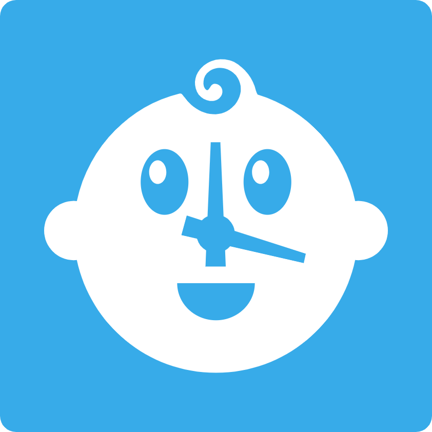

# Babubi

A buddy for babies! Helps caregivers track sleep, feedings, diaper changes,
tummy time and more to learn about and predict baby's needs without (_as much_)
guess work.

## 👾 Demo

A [demo of Babubi](https://demo.baby-buddy.net) is available. The demo instance
resets every hour. Login credentials are:

- Username: `admin`
- Password: `admin`

## 📘 Documentation

Visit [https://docs.baby-buddy.net](https://docs.baby-buddy.net) for full documentation.

### Additional documentation

- [Security](/SECURITY.md)
- [License](/LICENSE) (BSD-2 Clause)

## 🗺️ Languages

Babubi is available in a variety of languages thanks to the efforts of numerous
translators. Language can be set on a per-user basis from the user settings page
(`/user/settings/`). See [Contributing](https://docs.baby-buddy.net/contributing/translation/)
for information about how to create/update translations.

### Available languages

:brazil: Brazilian Portuguese, :es: Catalan, :cn: Chinese (simplified), :hong_kong: Chinese (traditional), :taiwan: Chinese (Taiwan), :croatia: Croatian, :czech_republic: Czech, :denmark: Danish, :netherlands: Dutch, :uk: English (U.K.), :us: English (U.S.) (base), :finland: Finnish, :fr: French, :de: German, :israel: Hebrew, :hungary: Hungarian, :it: Italian, :jp: Japanese, :kr: Korean, :norway: Norwegian Bokmål, :poland: Polish, :portugal: Portuguese, :ru: Russian, :serbia: Serbian, :mexico: :es: Spanish, :sweden: Swedish, :tr: Turkish, :ukraine: Ukrainian

## 🌐 Babubi on the Web

This is a non-exhaustive list of neat projects and blog posts that either extend
or use Babubi in fun ways. If you have a project to share please open a PR
adding it here or reach out via GitHub Issues or Discussions or on Gitter!

### AI

- [Babubi MCP server](https://github.com/babybuddy/babybuddy-mcp) - A [Model Context Protocol](https://modelcontextprotocol.io) server for logging and querying Babubi data with AI assistants. See the [MCP documentation](https://docs.baby-buddy.net/mcp/).

### Smart home

- [Home Assistant Addon](https://github.com/OttPeterR/addon-babybuddy) (host Babubi on Home Assistant)
- [Home Assistant integration](https://github.com/jcgoette/baby_buddy_homeassistant) (monitor and use Babubi from Home Assistant)
- [How to Setup Babubi in Home Assistant](https://smarthomescene.com/guides/how-to-setup-baby-buddy-in-home-assistant/)
- [Babubi and Home Assistant](https://martinnoah.com/babybuddy-and-home-assistant.html)
- [Alexa skill](https://github.com/babybuddy/babybuddy-alexa-skill)

### Hardware

- [Bottle Scale for Babubi and Home Assistant with ESPHome](https://github.com/sfgabe/OITProjects/tree/master/BabyBuddy_ESP_HASS)
- [Quick Entry Keypad (ESP8266)](https://github.com/sfgabe/OITProjects/tree/master/Baby_Buddy_Keypad)
- [Babubi Keypad (ESP32)](https://github.com/jeroenterheerdt/Baby-Buddy-Keypad)
- [BabyScout](https://github.com/MikeSchapp/BabyScout) - Keypad for recording diaper changes, feedings and sleep to Babubi
- [BabyPod](https://www.printables.com/model/872095-babypod-a-remote-control-for-baby-buddy-for-new-pa) - A remote control for Babubi for new parents (sources: [hardware](https://github.com/skjdghsdjgsdj/babypod-hardware), [software](https://github.com/skjdghsdjgsdj/babypod-software/))
- [MatrixPortal Babubi](https://github.com/skjdghsdjgsdj/matrixportal-babybuddy)

### Mobile

- [Babubi Companion for iOS](https://apps.apple.com/app/id6788966667) ([Source](https://github.com/kguy18/babybuddyios/))
- [Babubi for Android](https://play.google.com/store/apps/details?id=eu.pkgsoftware.babybuddywidgets) ([Source](https://github.com/babybuddy/babybuddy-for-android))
- [iOS shortcuts](https://github.com/babybuddy/babybuddy/discussions/300)
- [Convert exported data from "Baby tracker - feeding, sleep and diaper" mobile app to Babubi](https://github.com/babybuddy/babybuddy/discussions/424)

### Videos

- [Babubi: Keep Records of Your Child/Baby's Growth and Activities](https://www.youtube.com/watch?v=sO6rjn2s6-k)

### Other

- [Grafana Dashboard](https://github.com/babybuddy/babybuddy/discussions/607)
- [Sandstorm app](https://github.com/babybuddy/babybuddy-sandstorm)
- Newborn parenting software series (API, buttons, LCD information screen!)
  - [part 1](https://lutzky.net/2021/10/03/software-parenting-1/)
  - [part 2](https://lutzky.net/2021/10/05/software-parenting-2/)
  - [part 3](https://lutzky.net/2021/10/10/software-parenting-3/)
- [High Level Developer Documentation (AI-Generated)](https://wiki.mutable.ai/babybuddy/babybuddy)
- [Example custom TypeScript frontend](https://github.com/jkjustjoshing/maddie-buddy) (based on [Remix](https://remix.run/))

## 🔐 Reporting Vulnerabilities

See [SECURITY.md](SECURITY.md) for information about where and how to report
potential Babubi vulnerabilities.

## ❤️ Support

### Contribution and sponsorship

Contribute or sponsor Babubi's contributors using any of the following methods:

- [Sponsor @babubi on GitHub](https://github.com/sponsors/babybuddy)
- [Sponsor @cdubz on GitHub](https://github.com/sponsors/cdubz)
- [Contribute on Open Collective](https://opencollective.com/babybuddy)

### Tools and infrastructure

The following organizations and services support Babubi contributors in various ways (software licensing, service credits, etc.).

_Some of the links below use referral codes -- all referral proceeds are treated as contributions to the Babubi project._

