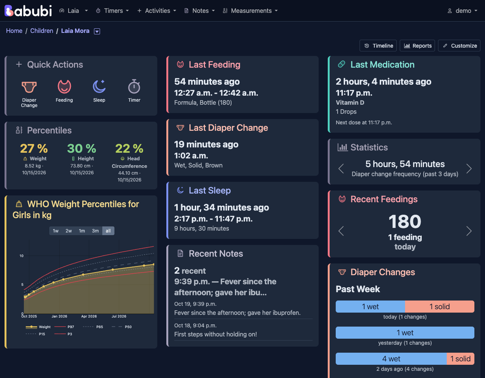
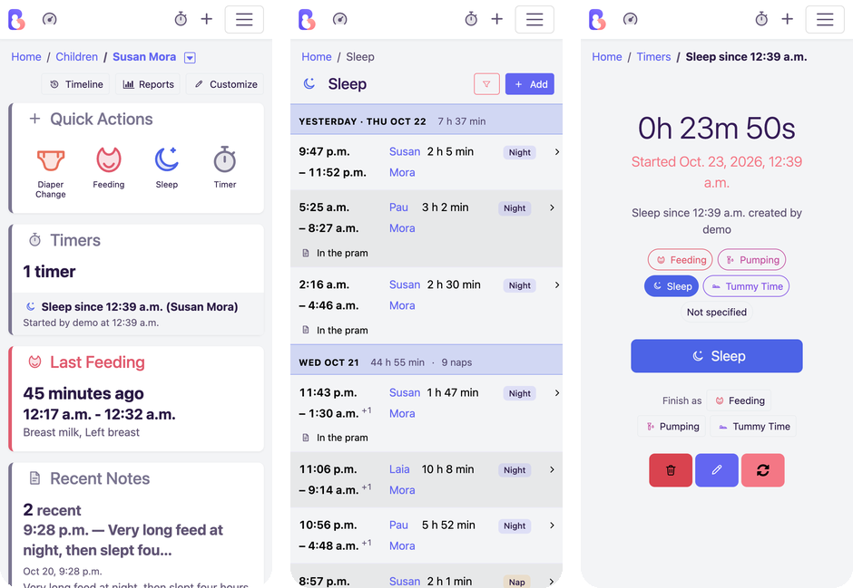
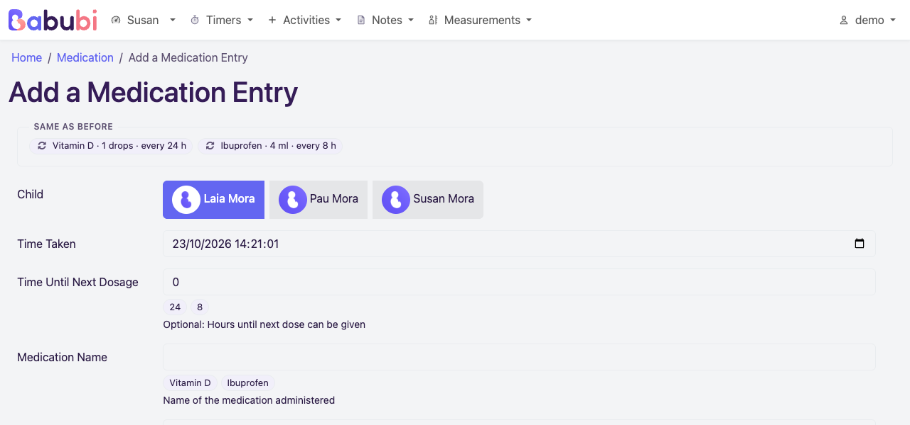
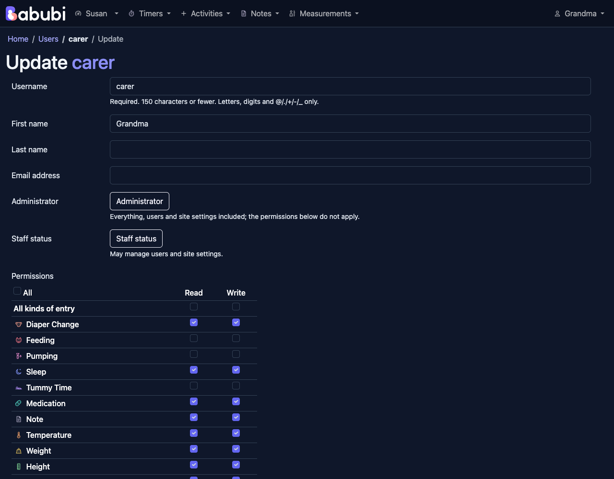

# Babubi

[](LICENSE)
[](https://github.com/icon42/babubi/actions/workflows/ci.yml)
[](SUPPORT.md)

Babubi is a self-hosted baby tracker for the whole family: feedings, sleep, diaper changes, pumping, tummy time, medication, measurements and notes, logged in a couple of taps from a phone or a desktop, with a dashboard per child that each caregiver arranges to their liking.

Babubi is a fork of [Baby Buddy](https://github.com/babybuddy/babybuddy). It starts from Baby Buddy's tagged releases and adds its own packaging and changes on top. It is not affiliated with the Baby Buddy project.









## How Babubi differs from Baby Buddy

- **A dashboard per child, arranged by each caregiver**: three columns of cards to drag around, hide and bring back, with an order of their own on a phone, a card of quick actions drawn like a phone's home screen that open each activity's list for the child, its add form (marked with a plus) or start a timer, graph cards with any report, and a percentiles card with the exact WHO percentiles of the latest weight, height and head circumference.
- **Child-first menu.** The menu starts with the child whose dashboard was opened last and leads back to it; the other children are one tap away.
- **Timers that know what they time.** A timer is started as a feeding, pumping, sleep or tummy time timer, from the quick actions, the phone's stopwatch button or the Timers menu, and one button finishes it and opens that activity's form filled in.
- **Lists grouped by day**, with a summary row per day, the time since the previous entry, and sleep drawn as bars with its nap or night badge.
- **Frequent values under form fields**: the medication names, doses and intervals, the amounts and the short notes used before, filled in with a click. Above the medication and feeding forms, **"Same as before"** repeats a recent treatment or feeding, every field at once.
- **Permissions per user**, in the user form: a matrix of what each user may read and write, per activity and measurement, with an "All" per column that also covers kinds added later. It sets Django's model permissions, so the web interface, the API and the MCP server all honour it.
- **WHO head circumference charts** for boys and girls, next to the weight and height ones; a child's sex picks the right charts.
- **A colour and an icon per activity**, light, dark and automatic themes, and a baby placeholder drawn from the logo.
- **Own container image**, published at `ghcr.io/icon42/babubi` for amd64 and arm64 and rebuilt every week so its base gets security fixes. It runs as an unprivileged user.
- **Private uploads.** Child pictures and other uploads are served only to signed-in users and to API clients with a valid token, never to anyone who just has the URL.
- **Locale defaults from the environment.** `LANGUAGE_CODE` and `TIME_ZONE` set the defaults for new users; without them Babubi uses Baby Buddy's (`en-US`, `UTC`).
- **Your own logo and styles** without rebuilding the image: drop `logo.svg`, `icon.svg` or `custom.css` into `/config/branding/` (see [`BRANDING_DIR`](docs/configuration/application.md#branding_dir)).
- **OpenID Connect login** with any provider, alongside passwords or instead of them, including back-channel logout; accounts link by verified email or from the user's settings (see [`LOGIN_METHODS`](docs/configuration/security.md#login_methods)).
- **A REST API that knows the additions** (a child's sex, a timer's kind) and a [Model Context Protocol server](https://github.com/icon42/babubi-mcp) to log and query from AI assistants.
- **Drop-in migration from Baby Buddy.** Its `/config` volume matches the linuxserver Baby Buddy image, and the first start moves the database over to Babubi on its own.

## Getting started

Babubi runs as a container behind a reverse proxy that terminates TLS. A minimal Docker Compose service:

```yaml
services:
  babubi:
    image: ghcr.io/icon42/babubi:1
    environment:
      - ALLOWED_HOSTS=babubi.example.com
      - CSRF_TRUSTED_ORIGINS=https://babubi.example.com
      - SECURE_PROXY_SSL_HEADER=True
    volumes:
      - /path/to/appdata:/config
    restart: unless-stopped
```

The first start creates the user `admin` with the password `admin`: log in and change it immediately. See [Deployment](docs/setup/deployment.md) for the full setup, including how to move an existing Baby Buddy installation to Babubi.

## Versions

Babubi has its own version numbers and follows [Semantic Versioning](https://semver.org/). Each release tag also names the Baby Buddy release it builds on, as build metadata: `v1.0.0+bb.2.11.0` is Babubi 1.0.0 on top of Baby Buddy 2.11.0. The same Baby Buddy release can carry several Babubi versions, and a new Baby Buddy release always comes in with a new Babubi version.

Container tags hold the Babubi version only (`1.0.0`, `1.0`, `1` and `latest`), since they cannot contain a `+`. The image label `babubi.upstream` records the Baby Buddy release.

## Documentation

The documentation lives in the [`docs`](docs/index.md) directory of this repository:

- [Deployment](docs/setup/deployment.md), [HTTPS/SSL](docs/setup/ssl.md), [reverse proxies](docs/setup/proxy.md) and [subdirectories](docs/setup/subdirectory.md)
- [Configuration](docs/configuration/intro.md) through environment variables
- [User guide](docs/user-guide/getting-started.md)
- [API](docs/api.md), [import and export](docs/import-export.md) and the [MCP server](docs/mcp.md)
- [Contributing](docs/contributing/pull-requests.md), including [translations](docs/contributing/translation.md)

## Languages

Each user picks their language in their settings (`/user/settings/`); `LANGUAGE_CODE` sets the default. Translations come from Baby Buddy's translators and are edited in the `.po` files under [`locale`](locale); see [Translation](docs/contributing/translation.md).

Available languages: Brazilian Portuguese, Catalan, Chinese (simplified), Chinese (traditional), Chinese (Taiwan), Croatian, Czech, Danish, Dutch, English (U.K.), English (U.S., the base language), Finnish, French, German, Hebrew, Hungarian, Italian, Japanese, Korean, Norwegian Bokmål, Polish, Portuguese, Russian, Serbian, Spanish, Swedish, Turkish and Ukrainian.

## Works with the Baby Buddy ecosystem

Babubi keeps Baby Buddy's REST API unchanged, so apps and integrations built for Baby Buddy are expected to work with it. They are made by others for Baby Buddy, and none of them has been tested with Babubi.

### AI

- [babubi-mcp](https://github.com/icon42/babubi-mcp): a [Model Context Protocol](https://modelcontextprotocol.io) server for logging and querying Babubi data with AI assistants, forked from babybuddy-mcp alongside Babubi. See the [MCP documentation](docs/mcp.md).

### Smart home

- [Baby Buddy Home Assistant integration](https://github.com/jcgoette/baby_buddy_homeassistant): monitor and use Babubi from Home Assistant
- [Baby Buddy Alexa skill](https://github.com/babybuddy/babybuddy-alexa-skill)

### Hardware

- [Bottle Scale for Baby Buddy and Home Assistant with ESPHome](https://github.com/sfgabe/OITProjects/tree/master/BabyBuddy_ESP_HASS)
- [Quick Entry Keypad (ESP8266)](https://github.com/sfgabe/OITProjects/tree/master/Baby_Buddy_Keypad)
- [Baby Buddy Keypad (ESP32)](https://github.com/jeroenterheerdt/Baby-Buddy-Keypad)
- [BabyScout](https://github.com/MikeSchapp/BabyScout): keypad for recording diaper changes, feedings and sleep
- [BabyPod](https://www.printables.com/model/872095-babypod-a-remote-control-for-baby-buddy-for-new-pa): a remote control for new parents (sources: [hardware](https://github.com/skjdghsdjgsdj/babypod-hardware), [software](https://github.com/skjdghsdjgsdj/babypod-software/))
- [MatrixPortal Baby Buddy](https://github.com/skjdghsdjgsdj/matrixportal-babybuddy)

### Mobile

- [Baby Buddy Companion for iOS](https://apps.apple.com/app/id6788966667) ([source](https://github.com/kguy18/babybuddyios/))
- [Baby Buddy for Android](https://play.google.com/store/apps/details?id=eu.pkgsoftware.babybuddywidgets) ([source](https://github.com/babybuddy/babybuddy-for-android))
- [iOS shortcuts](https://github.com/babybuddy/babybuddy/discussions/300)
- [Convert exported data from the "Baby tracker - feeding, sleep and diaper" app](https://github.com/babybuddy/babybuddy/discussions/424)

### Other

- [Grafana dashboard](https://github.com/babybuddy/babybuddy/discussions/607)
- Newborn parenting software series (API, buttons, LCD information screen): [part 1](https://lutzky.net/2021/10/03/software-parenting-1/), [part 2](https://lutzky.net/2021/10/05/software-parenting-2/), [part 3](https://lutzky.net/2021/10/10/software-parenting-3/)
- [Example custom TypeScript frontend](https://github.com/jkjustjoshing/maddie-buddy), based on [Remix](https://remix.run/)

## Support

Babubi is offered as is, without support; see [SUPPORT.md](SUPPORT.md).

## Reporting vulnerabilities

See [SECURITY.md](SECURITY.md).

## License and credits

Babubi is released under the [BSD 2-Clause License](LICENSE), like Baby Buddy, and keeps the copyright notice of Baby Buddy's contributors. Almost all of Babubi's code, design and translations is their work.
